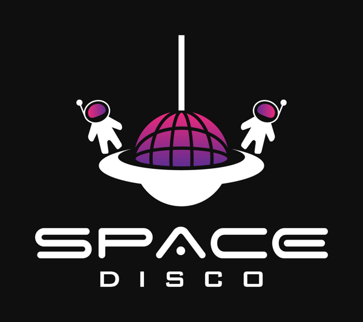

<p align="center">
  
</p>

<h1 align="center">pow.fm</h1>

<p align="center"><strong>pow.fm desktop: an Electron Forge + React + TypeScript starter for a music app.</strong></p>

<p align="center"><em>"We are going to space and we are bringing a disco."</em> 🚀🪩</p>

> **Status:** Template only. · **Visibility:** public · **Language:** TypeScript · **History:** 2022-12-05 → 2022-12-05, 1 commits

## 🪩 What this is

Single commit: the Electron Forge webpack + TypeScript template, intended as the desktop shell for pow.fm (a music/proof-of-work idea). No app code yet.

## 🎛️ Stack

- Electron Forge (webpack plugin)
- TypeScript

## 🗺️ Layout

| Path | What it does |
| --- | --- |
| `pow.fm-desktop/src/index.ts` | main process |
| `pow.fm-desktop/src/renderer.ts, preload.ts, index.html` | renderer |

## 🚀 Launch sequence (local setup)

```bash
cd pow.fm-desktop
yarn
yarn start
```

## 🛸 Deploy

`electron-forge make` builds installers locally.

## 🔌 Integrations

None.

## 🧪 Tests & CI

None.

## 🛰️ Current state

Template only.

## 🌌 How it connects

Shares the Electron Forge template with another Space Disco desktop experiment.

---

<p align="center"><sub>Space Disco · Orbital Lounge and House Music Club · Deep, Minimal, Tech House &amp; Soulful, Groovy, Funky, Disco House.<br>Documentation refreshed November 2026 from a read of the code and history.</sub></p>
